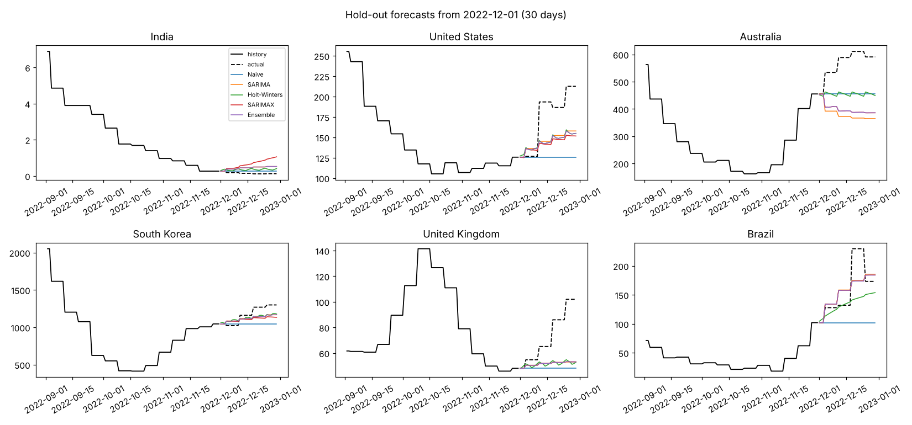
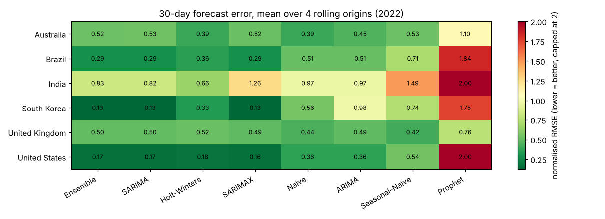
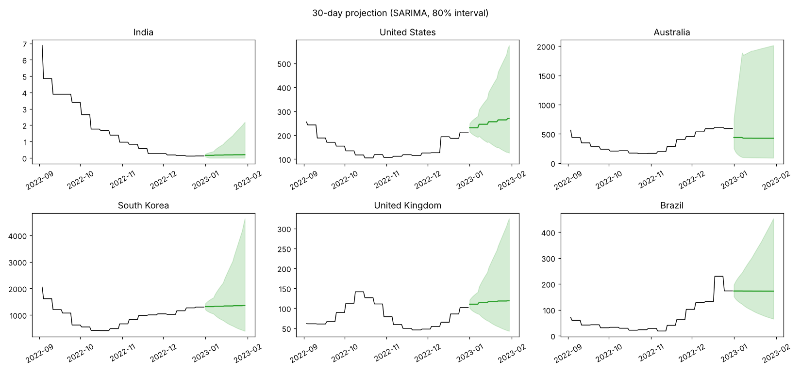
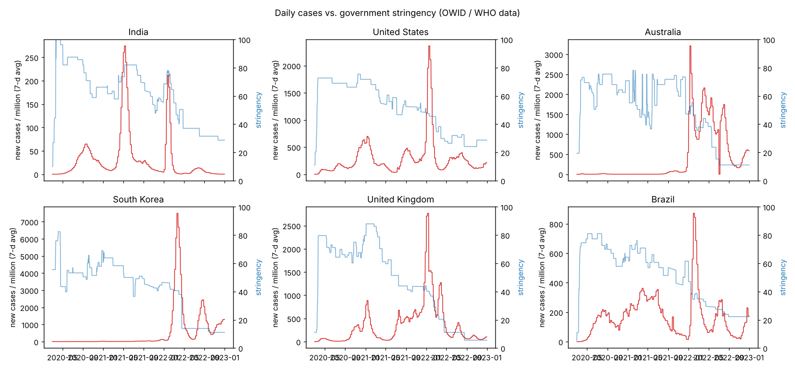

# Predicting COVID-19 Trends using Time-Series Models

[](https://github.com/Drakeion2532/covid19-time-series-forecasting/actions/workflows/tests.yml)

30-day forecasting of daily COVID-19 cases across **6 countries** (India, United States, Australia, South Korea, United Kingdom, Brazil). The benchmark compares ARIMA, SARIMA, SARIMAX (with policy and vaccination features), Holt-Winters, Prophet and an ensemble against naive baselines, using a rolling-origin backtest.

Reference implementation of the research paper **"Predicting COVID-19 Trends using Time Series Models"**: H. T. Chaudhari, A. G. Jadhav, I. S. Pathare, **S. S. Punde**. The work was done during the research internship at the **University of Nevada, Las Vegas (UNLV)**, Summer 2024.



## Why it matters

Hospitals and public-health teams need to know **how many cases to expect over the next weeks** to plan beds, staff and testing. This project shows which classical forecasting models hold up across countries with very different epidemic curves and policies. It also shows where they fail.

## Pipeline

1. **Data**: Our World in Data COVID-19 dataset (aggregates WHO + JHU). Subset at `data/raw/owid_covid_6_countries.csv`.
2. **Cleaning** (as in the paper): outliers flagged by both a rolling z-score (|z| > 3) and a rolling IQR rule are treated as missing, then forward-filled and back-filled.
3. **Target**: `new_cases_smoothed_per_million`, modelled on a log scale.
4. **Exogenous features** (SARIMAX): Oxford stringency index and % of people vaccinated. At forecast time only the last observed value is used, so there is **no look-ahead leakage**.
5. **Evaluation**: rolling-origin backtest with 4 forecast origins in 2022 × 6 countries × 30-day horizon. Each model is refit on the preceding 365 days. Metrics: **MSE, RMSE, MAE** (the paper's metrics) plus MAPE and normalised RMSE.

## Results

Mean over 6 countries × 4 origins (lower is better). The improvement column is measured against the naive "tomorrow = today" forecast.

| Model | nRMSE | MAPE | vs. Naive |
|---|---|---|---|
| **Ensemble** (median of SARIMA, SARIMAX, Holt-Winters) | **0.404** | 36.6% | **+25.0%** |
| SARIMA (2,1,2)(1,0,1)₇ | 0.406 | 36.7% | +24.6% |
| Holt-Winters (damped, weekly) | 0.407 | **34.0%** | +24.5% |
| SARIMAX (+ stringency, vaccination) | 0.475 | 43.8% | +11.9% |
| Naive | 0.539 | 53.9% | – |
| ARIMA (auto order) | 0.628 | 61.1% | −16.6% |
| Seasonal-Naive (same day last week) | 0.738 | 78.6% | −36.9% |
| Prophet | 2.131 | 245.6% | −295% |

**Best model per country (RMSE):** India: SARIMA · South Korea: SARIMA · United States: SARIMAX · Brazil: SARIMAX · Australia: Holt-Winters · United Kingdom: Seasonal-Naive



### Findings

* **Weekly seasonality matters.** SARIMA beats ARIMA by about 35% nRMSE because reporting follows a 7-day cycle. (In the paper SARIMA was the best model for the United States; in this backtest SARIMAX edges it out there, as described below.)
* **Exogenous features help where policy was still changing.** SARIMAX wins for the US and Brazil, but by late 2022 most stringency indices were flat, so the extra features added little elsewhere.
* **Prophet is a poor fit for 30-day epidemic forecasting.** Its piecewise-linear trend extrapolates the slope of the last wave and overshoots badly. This is a known limitation worth knowing before using it in production.
* **The ensemble is the safest choice.** It is never the worst model and is best on average, though only just ahead of SARIMA (0.404 vs 0.406). Its three members were chosen after seeing this backtest, so its lead is slightly optimistic; a stricter test would pick members on 2021 origins and score them on 2022.
* Full per-country, per-origin numbers are in `results/backtest_all.csv` and `results/summary.json`.

### 30-day projection

`results/forward_forecast_30d.json` holds a 30-day projection beyond the end of the daily data, with 80% prediction intervals.





## Run it

```bash
pip install -r requirements.txt
python -m covid_forecast.evaluate   # backtest -> results/backtest_all.csv, summary.json (~1-2 min)
python -m covid_forecast.report     # figures + 30-day forward forecast
pytest -q
```

To refresh the data from the full OWID file:

```bash
curl -L -o owid.csv https://raw.githubusercontent.com/owid/covid-19-data/master/public/data/owid-covid-data.csv
```

Then filter it to the countries you want (see `covid_forecast/data.py`).

## Notes and limitations

* Daily data with stringency coverage runs from **2020-03-01 to 2022-12-31**. After 2022 several countries switched to weekly reporting, which is visible as the step shape in late-2022 curves.
* Case counts depend on testing volume. A drop in reported cases may reflect less testing rather than less infection.

## Structure

```
covid_forecast/
  data.py       loading, outlier handling (z-score + IQR), ffill/bfill
  models.py     Naive, Seasonal-Naive, ARIMA, SARIMA, SARIMAX, Holt-Winters, Prophet, Ensemble
  evaluate.py   rolling-origin backtest + metrics
  report.py     figures + forward forecast
data/raw/       6-country dataset (OWID, CC-BY 4.0)
results/        metrics, forecasts, figures
tests/
```

Data: Mathieu, E. et al. *Coronavirus Pandemic (COVID-19)*, Our World in Data (CC BY 4.0).
